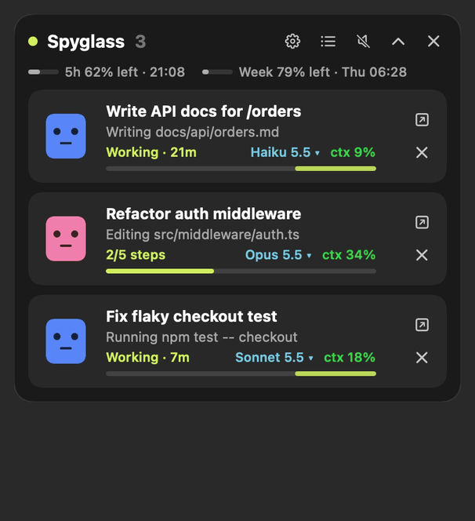

# Spyglass

[](https://github.com/shivanitomar9812-ship-it/spyglass/actions/workflows/ci.yml)

**A floating panel for every Claude Code session on your Mac.**

Running several Claude Code sessions at once? Spyglass keeps a small always-on-top panel with one row per session: what it's doing right now, which ones need you, how much of your plan you've used. You can answer most prompts from the panel itself, and jump to the exact terminal tab for the rest.

<p align="center"></p>

<p align="center"><a href="demo/spyglass-demo.mp4">Watch the 30-second video</a></p>

## What it shows

- 🟢 **Working**: live activity ("Running kubectl get pods", "Editing api.ts"), `3/5 steps` on a task list, elapsed time otherwise
- 🟠 **Needs you**: permission prompts and questions float to the top with an orange outline, including a turn that simply ends by asking you something ("Shall I go ahead?")
- ✅ **Done**: finished turns, ready for your next prompt
- **Names you recognise**: the same name as the session's Cursor / VS Code tab, else your `/rename`, else Claude's own title
- **Search**: with 5+ sessions, a field above the list filters by tab name, folder, model or what a session is doing (several words narrow it; Esc clears). Sessions waiting on you that a search hides are counted, never silently hidden
- **Model and context** on every row; at 85% context the row turns red, with one sound, so you can `/compact` first
- **Usage that fits your plan**: on a subscription, the header shows how much of the 5-hour and weekly limits is left and when they renew, and rows show tokens used. On an API key, rows show $. Past a limit, the header says extra usage is billed at API prices (if it's on) and rows show the $ added since. Behind a spend-capped Claude gateway, the header shows the spend
- **Last line**: finished rows preview the last line of Claude's reply
- **Restart hints**: ↻ on rows whose hooks are older than the installed Spyglass (`claude --resume` brings the newest features)
- **Settings** (⚙): sounds, coming back, compact view, start at login, shortcuts
- **Keyboard**: ⌃⌥S shows / hides Spyglass, ⌃⌥J jumps to the session that has waited on you longest
- **Waiting on you**: "Needs you · 7m" on a row, and how long sessions waited on you today in the header
- **Self-check**: a session started after installing Spyglass that isn't reporting through its hooks gets a ⚠︎, and `/spyglass:doctor` says what's wrong
- **Quiet sessions**: if a session's hooks stop reporting while its conversation keeps moving, the row gets a ⚠︎ after 5 minutes and stops claiming "working" after 30, so a stale row never looks current
- **Risky commands never get one click**: deletes, force-pushes, production hosts, cluster and cloud changes and the like show a warning with only Review and Deny. The lock in the header turns Allow off for every prompt
- **Remote Control per row**: a small phone icon on each row, green with radio waves when that session is connected to Remote Control (Claude Code's own phone link: the session shows up in the Claude mobile app). Click to connect or disconnect an idle or finished session. In iTerm2 it does the whole thing; in Cursor / VS Code and Terminal it connects the same way, but to disconnect it opens Claude Code's menu and you pick **Disconnect this session** (Spyglass can't see those screens, so it won't press keys blind)
- **Hover for context**: how long it has been working or waiting, last prompt, folder and branch, model, context, tokens, and which tab it lives in
- **Compact view**: one line per session, grouped by repo; rows that need you stay full size
- **Collapsed, it still tells you what rang**: under the header, one line for each session that needs you or just finished. Click a "Needs you" line to open it in place and answer; click a "Done" line to jump
- **Recently ended**: sessions that ended in the last 24 hours (`/exit`, a crash, a closed terminal), with **Resume**
- **Every session shows up**, including ones started before Spyglass was installed (read from Claude Code's own session registry)

## What you can do from the panel

| Action | What Spyglass does |
|---|---|
| **Allow once / Deny** a permission prompt | answers it through Claude Code's permission hook, so it works wherever the session runs (terminal, Claude panel, JetBrains, cmux). The terminal prompt stays usable and the first answer wins; Deny stops the turn like Esc. Never "always allow". Risky commands get a warning and no Allow: you review and answer them in the terminal. Built in: recursive deletes, `sudo`, any `git push`, publishing, production hosts, Kubernetes / Helm / Argo CD / Terraform / cloud changes, SQL writes and migrations, Redis / MongoDB writes, HTTP write requests, `curl | sh`. Add your own in ⚙ → **Risky commands…**, switch a built-in one off there with `!` and its name (e.g. `!pushes to a remote`), or turn off **Allow from the panel** (the lock in the header, or ⚙) to answer every prompt in its tab |
| **Answer a question** (single choice, up to 4 options) | presses the option's number; bigger questions point you to the terminal |
| **Reply** to a question Claude asks in text | **Yes / No** for yes/no questions, or **Reply…** for one line; typed only while the session waits on you, only where Spyglass can type, never a slash command |
| **Switch model** (Opus, Sonnet, Haiku) | asks you to confirm, types `/model`, answers Claude Code's "Switch model?" prompt, and leaves your default model for new sessions unchanged |
| **Rename** (pencil on hover) | runs `/rename` and renames the terminal tab to match |
| **Resume** an ended session | opens a new tab in the same terminal and runs `claude --resume` in its folder |
| **Connect / disconnect Remote Control** (phone icon on a row) | idle or finished sessions only; connecting types `/remote-control`; disconnecting in iTerm2 opens its menu and picks Disconnect after checking the menu is on screen, elsewhere it opens the menu for you to pick |
| **Jump** (click the row, or ↗) | brings that exact tab to the front |
| **Allow once / Deny from your phone** (away mode) | while you're away, what needs you goes to a private Telegram chat; Allow once / Deny buttons there answer permission prompts. Risky commands only get Deny. See [Away mode](#away-mode) |

The panel stays out of the way: it never takes focus from your editor, ✕ hides it (the menu bar icon brings it back), and it **comes back by itself** when a session newly needs you.

## Where it works

| Where the session runs | Shows in Spyglass | Jump | Allow / Deny | Model switch, rename | Question answers | Tested live |
|---|---|---|---|---|---|---|
| iTerm2 | ✅ | exact tab | ✅ | ✅ | ✅ | ✅ |
| Cursor / VS Code / Windsurf terminal | ✅ | exact tab (run `/spyglass:editor` once) | ✅ | ✅ | ✅ | ✅ |
| Terminal.app | ✅ | exact tab | ✅ | ✅ | jump there (its scripting presses Enter after every key) | ✅ |
| cmux | ✅ | brings cmux forward (it refuses outside control) | ✅ | jump there | jump there | partly: refusal confirmed |
| Claude Code panel in Cursor / VS Code | ✅ | focuses Claude in that window | ✅ | jump there | jump there | not yet |
| JetBrains IDEs | ✅ | opens the IDE | ✅ | jump there | jump there | not yet |
| Other terminals (Ghostty, Warp, kitty…) | ✅ | brings the app forward | ✅ | jump there | jump there | not yet |
| Claude desktop app (Code) | ❌ runs in the cloud or a sandboxed VM that doesn't load your plugins | — | — | — | — | ✅ |

Allow / Deny works in every host where the plugin's hooks run (sessions started before installing or updating Spyglass use keystrokes until they restart). Spyglass only shows a button where it works; elsewhere it offers a one-click jump to answer in place.

## Install

Inside Claude Code:

```
/plugin marketplace add shivanitomar9812-ship-it/spyglass
/plugin install spyglass@spyglass
```

Start a new Claude Code session and the panel appears in the top-right corner, with a short welcome card and a setup checklist that ticks itself off. Drag the panel wherever you like; it remembers.

Optional:

```
/spyglass:login on     # start the panel when you log in
/spyglass:editor       # Cursor / VS Code: jump to, type into and reopen terminal tabs (reload the window once after)
/spyglass:open         # reopen the panel if you quit it
/spyglass:doctor       # check every link from this session to the panel, with fixes
/spyglass:uninstall    # undo everything Spyglass changed on this Mac (lists it first)
```

Then run once:

```
/spyglass:setup        # model, context and plan usage on each row (wraps your statusline; never edits it)
/spyglass:setup tabs   # …and show Claude's session names on unnamed Cursor / VS Code tabs
```

`/spyglass:setup` feeds Spyglass the data Claude Code only gives to the statusline. It wraps whatever statusline you have, so it looks exactly as before (or adds a short one if you have none), backs up `settings.json` first, and `/spyglass:setup off` puts your original back.

**Requirements:** macOS 13+, Claude Code (verified with 2.1.330; `/spyglass:doctor` tells you if yours is newer). Nothing else to install: a prebuilt universal binary is included (if it can't run, Spyglass builds itself with the Xcode Command Line Tools).

## How it works

The panel is a native SwiftUI app. It reads, once a second:

| Source | Gives |
|---|---|
| Claude Code's session registry (`~/.claude/sessions/`) | every running session, even without the plugin's hooks |
| The plugin's hooks → `~/.claude/spyglass/sessions/` | activity, task progress, permission prompts and questions, which terminal tab |
| Your statusline → `~/.claude/spyglass/stats/` | model, context, plan limits, API-price estimate |
| Session transcripts (read incrementally, in the background) | tokens used per session |
| The Cursor / VS Code extension → `~/.claude/spyglass/terminals/` | the names you gave your terminal tabs |

Permission prompts are answered through the plugin's `PermissionRequest` hook (`answer.sh`): while the panel runs, it waits for Spyglass's answer next to Claude Code's own prompt, accepts it only for the exact tool call it fingerprinted, and exits as soon as the prompt is answered anywhere.

For everything else, Spyglass types into the session's terminal: AppleScript for iTerm2 and Terminal.app, and the small editor extension for Cursor / VS Code (it matches the terminal by its shell's process ID). Everything it types is allow-listed (`/model opus|sonnet|haiku`, `/rename <one line>`, and the keys `1`–`4`, Esc, Enter), and keys are only sent while the prompt they answer is still pending.

The editor extension is a thin loader for `~/.claude/spyglass/editor-core.js`, which Spyglass refreshes on every update, so editor windows never need reloading after the first time.

**Privacy:** everything stays on your machine. No network calls, no telemetry. Spyglass's files hold session titles, the first 120 characters of your latest prompt, current tool descriptions, model and usage numbers, and terminal tab names. Session files are removed when a session ends; ended sessions are kept for 24 hours.

## Troubleshooting

| What you see | What to do |
|---|---|
| No panel | Click the menu bar icon (the antenna) → **Show Spyglass**, or run `/spyglass:open` |
| The panel hid and you want it back when something needs you | ⚙ → **Come back when a session needs you** |
| A row has ↻ or lacks a feature from the changelog | That session started before you updated; restart it with `claude --resume` |
| No model, context or usage on rows | Run `/spyglass:setup`; the numbers appear when each session's statusline next refreshes (send any message) |
| Cursor / VS Code: jump or typing does nothing, or "didn't answer" on hover | Run `/spyglass:editor`, then **Developer: Reload Window** once |
| iTerm2 / Terminal: jump or typing does nothing | Allow Spyglass in System Settings → Privacy & Security → Automation |
| A session is missing | Only sessions running on this Mac show up (not Claude desktop app or cloud sessions); sessions idle for 12 hours are summarised at the bottom |
| Anything not working as described | Run `/spyglass:doctor` in the session: it checks the panel, that session's hooks, the statusline, the editor extension and leftovers, and says what to fix |
| Something else | `~/.claude/spyglass/spyglass.log` has the panel's starts, exits and why it came back; open an issue with it and your Claude Code version |

## Away mode

Step away from the Mac and still unblock your sessions. With away mode on, a permission prompt, a question, or a turn that ends asking you something is sent to a private Telegram chat with the session name, its folder and the command. Permission prompts have **Allow once** and **Deny** buttons; questions and asks arrive as text and are answered at the Mac. The message loses its buttons when you answer at the Mac.

1. Create a bot: message @BotFather in Telegram, `/newbot`, copy the token.
2. In Claude Code run `/spyglass:away setup` and follow it: it has you run `! "$HOME/.claude/spyglass/Spyglass" away setup` yourself, so the token is typed hidden and never enters a Claude conversation. Message your new bot once so Spyglass learns your chat.
3. Switch it on with the paper-plane button in the panel header, or `Spyglass away on`. By default it also turns itself on when the screen locks or after 10 idle minutes, and off when you're back.

It follows the same rules as the panel: risky commands get no Allow (only Deny), the header lock turns Allow off for the phone too, a button works only for the prompt it was sent for and for one hour, and only your chat can answer. Settings in `~/.claude/spyglass/away.json`: `"finished": true` also pings when a session finishes, `"auto": false` turns the automatic switch off, `"idle_minutes"`. Telegram bot chats aren't end-to-end encrypted: see [SECURITY.md](SECURITY.md).

## Configuration

| Variable | Effect |
|---|---|
| `SPYGLASS_HOME` | Where state and the installed app live (default `~/.claude/spyglass`) |
| `SPYGLASS_DISABLE_PANEL=1` | Record state but don't launch the panel |
| `SPYGLASS_BUILD_FROM_SOURCE=1` | Build the binary on your Mac instead of using the prebuilt one (needs the Xcode Command Line Tools) |

## Uninstall

```
/spyglass:uninstall
/plugin uninstall spyglass@spyglass
```

`/spyglass:uninstall` lists everything Spyglass changed on this Mac (your statusline, the login item, the editor extension and tab-title setting, its state) and undoes it after you confirm. Then remove the plugin itself:

## Development

```bash
tests/run.sh                                     # regression checks: must print ALL PASSED
plugin/app/build.sh                              # native arch → plugin/bin/Spyglass
plugin/app/build.sh plugin/bin/Spyglass --universal
scripts/release.sh <version> "<subject>"         # tests → build → bump → push → plugin update → installed == running
demo/storyboard.sh                               # re-render the README GIF from scripted fake sessions (needs ffmpeg)
```

Code map: `plugin/app/` is the Swift app (`Store.swift` state and logic, `Views.swift` the panel, `CLI.swift` the hooks, JSON helper and doctor, `App.swift` window and menu bar, `TestMode.swift` `--selftest` / `--snapshot`); `plugin/scripts/` are the hooks and terminal plumbing; `plugin/editor-extension/` is the Cursor / VS Code side; `tests/` the regression checks.

[SECURITY.md](SECURITY.md) says what Spyglass trusts and what it can do to a session. [HARNESS.md](HARNESS.md) explains the checks and lists every bug that escaped them; [CHANGELOG.md](CHANGELOG.md) has the release history.

## License

MIT
